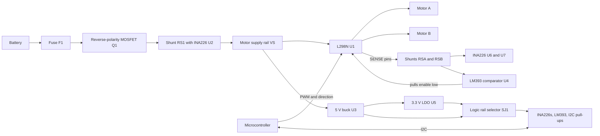

# L298N Dual Motor Driver with Power Monitoring

A custom KiCad PCB built around the **L298N** dual H-bridge. It improves on the common red L298N module with Schottky flyback diodes, reverse-polarity and surge protection, an onboard logic supply, voltage / current / power monitoring over I2C, and a hardware overcurrent limit that works without firmware.

> **Status: design stage.** The schematic and placement are complete, but the board has not yet been fabricated or tested. Check every IC pinout and footprint against the manufacturer datasheets before ordering PCBs.

---

## Features

- Drives **two independent brushed DC motors** (or one motor with both channels paralleled)
- **Schottky flyback diodes** (SS36) on all four outputs, instead of the slow 1N4007s on stock modules
- **Three INA226 monitors** over I2C:
  - supply voltage, total current and power
  - current of motor A
  - current of motor B
- **Hardware overcurrent limit** (LM393 comparators) that cuts the enable lines with no firmware involved
- **Input protection:** fuse, reverse-polarity P-MOSFET, TVS surge diode and a gate-clamp zener
- **Onboard logic supply:** 5 V buck converter (AP63205) plus a 3.3 V LDO
- **3.3 V or 5 V logic** selectable with a solder jumper, so it works with ESP32 / Pico / STM32 or 5 V Arduino boards
- **Pull-down and series resistors** on all control inputs, so the motors stay off while the MCU is unpowered or booting
- Hand-solderable parts (no BGA, no leadless packages)

## Specifications

| Item | Value |
|---|---|
| Motor driver | L298N, Multiwatt15 |
| Supply voltage | Mostly 12 V or below, designed for up to **24 V** |
| Motor current | 2 A continuous per channel, about 2.5 A repetitive peak, about 4 A total |
| Input path rating | Sized for **5 A** as headroom (fuse 6.3 A). This is not an expected load. |
| Voltage drop | The L298N's bipolar bridge drops roughly 2 to 4 V, so at 12 V a motor sees about 9 V |
| Logic level | 3.3 V or 5 V, set by SJ1 |
| Speed control | PWM on ENA / ENB |
| Direction control | IN1 to IN4 |
| Overcurrent limit | About 2.3 A per channel (adjustable with RV1), hiccup behaviour |
| Monitoring | 3 × INA226 at I2C addresses 0x40, 0x41, 0x42 |
| Board | 110 × 90 mm, 2 layers, 2 oz copper |
| Assembly | Hand soldering |

## Block diagram



## How it works

### Power path
Battery positive goes through the fuse (F1) and the P-channel MOSFET (Q1), which blocks reverse polarity. It then passes through the 15 mΩ shunt (RS1), which the first INA226 (U2) measures, and arrives at the motor supply rail. The TVS diode (D11) and 470 µF bulk capacitor (C1) sit on that rail, which feeds the L298N's VS pin and the buck converter.

### Logic power
The AP63205 buck converter makes 5 V from the supply rail. A 3.3 V LDO (AP2112K-3.3) follows it. The solder jumper **SJ1** chooses which of the two feeds the "logic rail", which powers the INA226s, the LM393 and the I2C pull-ups. Bridge it to match your microcontroller's logic level. The L298N's logic supply pin always runs from 5 V.

### Current monitoring
- **U2** measures the total current drawn from the supply across the 15 mΩ shunt RS1, plus the supply voltage and power.
- **U6** and **U7** measure each motor's current across a 33 mΩ shunt (RSA, RSB) connected to the L298N's SENSE pins.
- Each INA226 has 10 Ω input filter resistors and a 100 nF capacitor across its inputs.

### Hardware overcurrent limit
Each SENSE voltage also goes through a 1 kΩ / 100 nF filter to a comparator in the LM393 (U4). A trimmer (RV1) sets the reference to about 75 mV, which is roughly 2.3 A on a 33 mΩ shunt. When the current exceeds that, the comparator's open-collector output pulls the matching enable line low through a BAT54J Schottky diode, and the motor current falls. The limit is **not latched**: the motor restarts when the current drops, so a stalled motor pulses on and off.

### Input protection for control lines
IN1 to IN4 have 100 Ω series resistors and 10 kΩ pull-downs. ENA and ENB have 2.2 kΩ series resistors and 22 kΩ pull-downs. With the MCU off or disconnected, the bridge stays disabled.

## Bill of materials

**ICs and semiconductors**

| Ref | Part | Footprint |
|---|---|---|
| U1 | L298N (Multiwatt15) | `Package_TO_SOT_THT:TO-220-15_P2.54x2.54mm_StaggerOdd_Lead4.58mm_Vertical` |
| U2, U6, U7 | INA226AIDGSR | `Package_SO:VSSOP-10_3x3mm_P0.5mm` |
| U3 | AP63205WU-7 (5 V buck) | `Package_TO_SOT_SMD:TSOT-23-6` |
| U4 | LM393 (dual comparator) | `Package_SO:SOIC-8_3.9x4.9mm_P1.27mm` |
| U5 | AP2112K-3.3 (3.3 V LDO) | `Package_TO_SOT_SMD:SOT-23-5` |
| Q1 | P-MOSFET, 40 V, at least 10 A (e.g. AOD4185) | `Package_TO_SOT_SMD:TO-252-2` |
| D1 to D8 | SS36 (60 V, 3 A Schottky) | `Diode_SMD:D_SMA` |
| D9 | LED, green (power) | `LED_SMD:LED_0805_2012Metric` |
| D10 | BZT52B15 (15 V zener) | `Diode_SMD:D_SOD-123F` |
| D11 | SMAJ28A (unidirectional TVS) | `Diode_SMD:D_SMA` |
| D12, D13 | BAT54J (Schottky) | `Diode_SMD:D_SOD-323F` |

**Resistors** (0603 unless noted)

| Ref | Value | Purpose |
|---|---|---|
| R1 to R4 | 10 kΩ | Pull-downs on IN1 to IN4 |
| R5, R6 | 22 kΩ | Pull-downs on ENA / ENB |
| R7, R8 | 2.2 kΩ | Series on ENA / ENB |
| R9 | 10 kΩ | Q1 gate to GND |
| R10, R11 | 4.7 kΩ | SDA / SCL pull-ups |
| R12 | 10 kΩ | ALERT pull-up |
| R13 | 1 kΩ | Power LED |
| R14 | 47 kΩ | Comparator reference, top |
| R15, R16 | 1 kΩ | Comparator input filters |
| R17 | 100 kΩ | Buck EN pull-up |
| R18 to R21 | 100 Ω | Series on IN1 to IN4 |
| R22 to R27 | 10 Ω | INA226 input filters |
| RS1 | 15 mΩ, 1 W, 1%, 2512 | Supply shunt |
| RSA, RSB | 33 mΩ, 1 W, 1%, 2512 | Motor shunts |
| RV1 | 2 kΩ multiturn trimmer | Trip threshold (Bourns 3296W) |

**Capacitors**

| Ref | Value | Footprint |
|---|---|---|
| C1 | 470 µF, 50 V electrolytic | `Capacitor_THT:CP_Radial_D10.0mm_P5.00mm` |
| C5 | 10 µF, 50 V | `Capacitor_SMD:C_1206_3216Metric` |
| C6 | 22 µF, 16 V | `Capacitor_SMD:C_1206_3216Metric` |
| C8 | 1 µF | `Capacitor_SMD:C_0805_2012Metric` |
| C9 | 2.2 µF | `Capacitor_SMD:C_0805_2012Metric` |
| C2 to C4, C7, C10 to C18 | 100 nF, 50 V X7R | `Capacitor_SMD:C_0805_2012Metric` |

Ceramic capacitors lose capacitance under DC bias, so keep C5 and C6 in 1206 or larger.

**Other parts**

| Ref | Part | Notes |
|---|---|---|
| L1 | 4.7 µH shielded inductor, saturation current 3 A or more | The AP63205 datasheet recommends 4.7 µH for a 5 V output. Confirm against your datasheet. |
| F1 | 6.3 A fast-blow fuse, 5×20 mm, with PCB holder | |
| SJ1 | 3-pad solder jumper | Selects 5 V or 3.3 V logic |
| JP1, JP2 | 2-pad solder jumpers, bridged | Disconnect the I2C pull-ups if needed |
| J1 to J3 | 2-pin 5.08 mm screw terminals | Battery, motor A, motor B |
| J4 | 1×7 pin header | Control inputs |
| J5 | 1×5 pin header | I2C and alert |
| H1 to H4 | M3 mounting holes | Unplated, no electrical connection |
| TP1 to TP8 | Test points | |
| HS1 | Heatsink with thermal pad | Not on the PCB. Mounts on the L298N tab. |

**Totals:** 80 components, or 92 footprints including the mounting holes and test points. You also need to buy the fuse, the heatsink and an M3 screw for the L298N tab.

## Connector pinouts

| Connector | Pin | Signal |
|---|---|---|
| **J1** battery | 1 | Battery positive |
| | 2 | GND |
| **J2** motor A | 1, 2 | OUT1, OUT2 |
| **J3** motor B | 1, 2 | OUT3, OUT4 |
| **J4** control | 1 | ENA |
| | 2 to 5 | IN1, IN2, IN3, IN4 |
| | 6 | ENB |
| | 7 | GND |
| **J5** I2C | 1 | SDA |
| | 2 | SCL |
| | 3 | ALERT |
| | 4 | Logic rail output (3.3 V or 5 V, as set by SJ1) |
| | 5 | GND |

**SJ1:** pin 1 is +5 V, pin 3 is +3.3 V, and pin 2 (the centre pad) is the logic rail. Solder-bridge pins 1 and 2 for 5 V logic, or pins 2 and 3 for 3.3 V logic. Never bridge all three. Don't back-feed the logic rail from the MCU.

### L298N pin connections

| Pin | Signal |
|---|---|
| 1 | SENSE_A (to RSA, then GND) |
| 2, 3 | OUT1, OUT2 |
| 4 | VS (motor supply) |
| 5, 7 | IN1, IN2 |
| 6 | ENA |
| 8 | GND (the metal tab is also GND) |
| 9 | VSS (+5 V logic) |
| 10, 12 | IN3, IN4 |
| 11 | ENB |
| 13, 14 | OUT3, OUT4 |
| 15 | SENSE_B (to RSB, then GND) |

**Flyback diodes:** D1, D2, D5 and D6 go from OUT1, OUT2, OUT3 and OUT4 up to VS (anode on the output). D3, D4, D7 and D8 go from GND to OUT1, OUT2, OUT3 and OUT4 (anode on GND).

### INA226 pin connections (VSSOP-10)

| Pin | Name | U2 (supply, 0x40) | U6 (motor A, 0x41) | U7 (motor B, 0x42) |
|---|---|---|---|---|
| 1 | A1 | GND | GND | GND |
| 2 | A0 | GND | Logic rail | SDA |
| 3 | ALERT | ALERT | ALERT | ALERT |
| 4 | SDA | SDA | SDA | SDA |
| 5 | SCL | SCL | SCL | SCL |
| 6 | VS | Logic rail | Logic rail | Logic rail |
| 7 | GND | GND | GND | GND |
| 8 | VBUS | Motor supply rail | Same net as pin 9 | Same net as pin 9 |
| 9 | VIN− | Via R23 to the load side of RS1 | Via R25 to RSA's ground end | Via R27 to RSB's ground end |
| 10 | VIN+ | Via R22 to the battery side of RS1 | Via R24 to the SENSE_A pin | Via R26 to the SENSE_B pin |

The bus-voltage reading on U6 and U7 is meaningless (they see only millivolts), so ignore it.

## PCB layout

The board is 110 × 90 mm. The placement follows these principles:

- **Left edge:** battery connector, fuse, MOSFET, supply shunt, bulk capacitor and TVS, in the order the current flows
- **Centre:** the L298N with its heatsink below it, the control-input resistors above its pins, and the shunts at the two end pins
- **Top edge:** motor terminals J2 and J3 at the corners, with the control and I2C headers J4 and J5 between them
- **Flyback diodes:** in columns right beside the OUT pins
- **Bottom left:** the buck converter and the LDO, away from the sensing circuits
- **Bottom edge:** the test points

### Layout rules used

| Item | Value |
|---|---|
| Copper | 2 oz, 2 layers |
| Power tracks (VS, GND) | 2 mm or wider, or copper pours |
| Motor output tracks | 1.5 mm or wider |
| Signal tracks | 0.25 to 0.3 mm |
| Clearance | 0.3 mm or more (check your fab's minimum) |
| Part spacing | About 2 mm, for hand soldering |
| Mounting holes | 5 mm copper-free clearance |

1. **Place fixed parts first:** board outline, holes, connectors, L298N and heatsink space.
2. **Follow the current path:** each part next to the one it connects to.
3. **Keep switching loops small:** flyback diodes right at the OUT pins; buck SW node, L1 and the capacitors in one tight group.
4. **Decouple at the pins:** C2 and C3 at the L298N's pins 4 and 9, and 100 nF at every IC supply pin.
5. **Separate noisy and sensitive circuits:** keep the INA226 and comparator inputs away from the buck, the motor outputs and the heatsink.
6. **Use one solid ground pour,** and keep motor return current out of the sensing area.
7. **Kelvin sense connections:** run each INA226's sense traces as a thin pair from the inside of the shunt pads, separate from the power copper, and take IN− from the shunt's own ground pad.
8. **Thermal:** give the L298N, Q1 and the shunts copper area and thermal vias. Leave room for air around the heatsink.
9. **Route in order:** power and motor outputs first, then sense pairs, then control signals and I2C.

## Bring-up procedure

1. **Check for shorts** with a multimeter (VS to GND, +5 V to GND) before applying power.
2. **Populate the power section first:** fuse, Q1, RS1, the buck and the LDO. Power it from a **current-limited bench supply** at about 12 V with the limit near 0.2 A. Confirm +5 V and +3.3 V.
3. **Solder jumper:** bridge SJ1 to match your MCU.
4. **Add the L298N and diodes.** Test with no motor, then a small motor at low PWM.
5. **Add the INA226s one at a time,** scan the I2C bus, and compare the readings against a multimeter.
6. **Set the overcurrent trimmer last:** adjust RV1 while measuring the reference voltage (about 75 mV).

## Firmware notes

### I2C addresses

| Device | Address | Measures |
|---|---|---|
| U2 | 0x40 | Supply voltage, total current, power |
| U6 | 0x41 | Motor A current |
| U7 | 0x42 | Motor B current |

### Calibration

The INA226 calibration register value is `CAL = 0.00512 / (Current_LSB × R_shunt)`.

| Chip | Shunt | Current_LSB | CAL | Full-scale |
|---|---|---|---|---|
| U2 | 15 mΩ | 1 mA | 341 | About 5.4 A |
| U6, U7 | 33 mΩ | 0.5 mA | 310 | About 2.48 A (readings saturate here) |

The power register's LSB is 25 times the Current_LSB. The bus voltage LSB is 1.25 mV.

### Minimal example (Arduino-style)

```cpp
#include <Wire.h>

const uint8_t INA_SUPPLY  = 0x40;
const uint8_t INA_MOTOR_A = 0x41;
const uint8_t INA_MOTOR_B = 0x42;

void writeReg(uint8_t addr, uint8_t reg, uint16_t val) {
  Wire.beginTransmission(addr);
  Wire.write(reg);
  Wire.write(val >> 8);
  Wire.write(val & 0xFF);
  Wire.endTransmission();
}

int16_t readReg(uint8_t addr, uint8_t reg) {
  Wire.beginTransmission(addr);
  Wire.write(reg);
  Wire.endTransmission(false);
  Wire.requestFrom(addr, (uint8_t)2);
  return (Wire.read() << 8) | Wire.read();
}

void setup() {
  Serial.begin(115200);
  Wire.begin();
  // Configuration register (0x00): 64 averages, 1.1 ms conversion time
  writeReg(INA_SUPPLY,  0x00, 0x4727);
  writeReg(INA_MOTOR_A, 0x00, 0x4727);
  writeReg(INA_MOTOR_B, 0x00, 0x4727);
  // Calibration register (0x05)
  writeReg(INA_SUPPLY,  0x05, 341);
  writeReg(INA_MOTOR_A, 0x05, 310);
  writeReg(INA_MOTOR_B, 0x05, 310);
}

void loop() {
  float busV   = readReg(INA_SUPPLY, 0x02) * 1.25 / 1000.0;  // volts
  float supplyA = readReg(INA_SUPPLY,  0x04) * 1.0 / 1000.0; // amps
  float motorA  = readReg(INA_MOTOR_A, 0x04) * 0.5 / 1000.0; // amps
  float motorB  = readReg(INA_MOTOR_B, 0x04) * 0.5 / 1000.0; // amps
  Serial.printf("V=%.2f  I_total=%.3f  I_A=%.3f  I_B=%.3f\n",
                busV, supplyA, motorA, motorB);
  delay(200);
}
```

The `Serial.printf` call works on ESP32. On boards that lack it, format the output with `Serial.print` instead.

Set the undervoltage alert limit in U2's mask/enable and alert-limit registers to suit your battery chemistry.

## Known limitations

- **The L298N can't deliver 5 A.** The 5 A figure only sizes the input path. Real limits are 2 A per channel and about 4 A in total.
- **Voltage drop:** the L298N's bipolar bridge drops roughly 2 to 4 V, and at full load it dissipates several watts and needs a heatsink (about 3 °C/W or better for continuous use).
- **Overcurrent limit is a hiccup, not a latch.** A stalled motor pulses on and off, and the MCU isn't told when it trips.
- **No short-circuit protection on the motor outputs** beyond the fuse and the hiccup limit. The L298N has no fault flag.
- **Per-motor current readings under PWM** reflect only the on-time current. The motor's freewheeling current flows through the flyback diodes and doesn't pass the shunt, so the reading is lower than the smoothed motor current. Treat it as a trend or overload indicator.
- **INA226 bus voltage rating:** VBUS has a 40 V absolute maximum. The SMAJ28A TVS clamps at about 45 V at its full surge current, so only an extreme surge could exceed it. For a supply near 24 V, consider the SMAJ26A instead.
- **No isolation** between the motor side and the logic side. They share one ground.
- **No onboard temperature sensing or fan control.**
- **Hardest part to hand-solder:** the three VSSOP-10 INA226 chips.
- **Not yet built or tested.**

## Suggested repository structure

```
.
├── README.md
├── LICENSE
├── hardware/
│   ├── l298n-driver.kicad_pro
│   ├── l298n-driver.kicad_sch
│   ├── l298n-driver.kicad_pcb
│   └── gerbers/
├── docs/
│   ├── schematic.pdf
│   ├── bom.csv
│   └── images/
└── firmware/
    └── ina226_example/
```

## Design decisions

| Decision | Choice |
|---|---|
| Driver IC | Keep the L298N (not replaced by a MOSFET bridge) |
| Flyback diodes | Schottky SS36 instead of 1N4007 |
| Logic-side isolation | None. Series and pull-down resistors only. |
| Overcurrent protection | Comparator hiccup limit, no latch |
| Temperature sensor and fan | Left out to keep the board simple |
| Per-motor monitoring | Kept (one INA226 per motor) |
| Analog hardware P-loop | Not included. Closed-loop control is left to firmware. |

## License

Add a license before publishing. For open hardware, common choices are CERN-OHL-P (permissive) or CERN-OHL-S (share-alike) for the board files, and MIT for any firmware.

## Author

Your name here.
